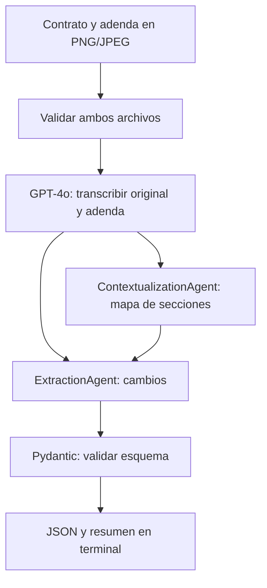

# LegalMove — Comparación de contratos de producción musical

Aplicación de terminal que compara un contrato original con su adenda a partir de dos imágenes PNG/JPEG. Devuelve un JSON validado y un resumen breve con las secciones afectadas, los temas, los tokens y el tiempo de ejecución.

Los casos de prueba se centran en producción musical: honorarios, entregas, rondas de correcciones, uso de grabaciones y confidencialidad. Los documentos son ficticios y fueron preparados para este proyecto.

## Arquitectura



El pipeline es secuencial y se instrumenta con Langfuse. Los agentes tienen clases y system prompts separados, implementados como cadenas de LangChain. El extractor recibe ambos textos completos además del mapa; no depende exclusivamente de la interpretación del primer agente.

## Requisitos y configuración

- Python 3.12, conexión a internet y Git para descargar el repositorio.
- Una API key de OpenAI con saldo y acceso a GPT-4o.
- Un proyecto de Langfuse Cloud con sus claves y la URL de su región.

```bash
git clone https://github.com/GonLucero/henry-ai-engineering.git
cd henry-ai-engineering/M4
python3.12 -m venv .venv
source .venv/bin/activate
python -m pip install -r requirements.txt
cp .env.example .env
```

Completar `.env` localmente:

```dotenv
OPENAI_API_KEY=tu-clave-de-openai
OPENAI_MODEL=gpt-4o
LANGFUSE_PUBLIC_KEY=tu-clave-publica
LANGFUSE_SECRET_KEY=tu-clave-secreta
LANGFUSE_BASE_URL=https://cloud.langfuse.com
```

La URL debe coincidir con la región del proyecto. También se acepta `LANGFUSE_HOST` como alternativa a `LANGFUSE_BASE_URL`. Las variables ya definidas en el entorno tienen prioridad sobre `.env`.

Las claves nunca se incluyen en el repositorio. Las bibliotecas LangChain y Pydantic no requieren cuentas. LangSmith no se utiliza.

Para comprobar los accesos con una llamada mínima que consume saldo:

```bash
python scripts/check_connection.py
```

## Ejecutar

Desde la carpeta `M4`, con el entorno virtual activado:

```bash
# Caso simple: cambia únicamente el precio
python src/main.py data/test_contracts/simple/original.png data/test_contracts/simple/adenda.png

# Caso complejo: modificaciones, eliminación y adición
python src/main.py data/test_contracts/complejo/original.png data/test_contracts/complejo/adenda.png
```

También acepta imágenes propias, no solamente las de ejemplo:

```bash
python src/main.py /ruta/contrato.png /ruta/adenda.jpg
```

El JSON se imprime en `stdout`; el resumen humano y los errores se imprimen en `stderr`. Para guardar únicamente el JSON:

```bash
python src/main.py data/test_contracts/simple/original.png data/test_contracts/simple/adenda.png > resultado.json
```

`--json-only` omite el resumen humano. `--output-dir carpeta` cambia dónde se guardan las ejecuciones. Cada ejecución exitosa crea una carpeta nueva con `report.json`, las dos transcripciones, `context_map.txt` y `run.json` con métricas y enlace a Langfuse. `outputs/` está excluida de Git.

El JSON final tiene exactamente estos campos:

```json
{
  "sections_changed": ["2"],
  "topics_touched": ["honorarios"],
  "summary_of_the_change": "MODIFICACIÓN: los honorarios pasan de ARS 300.000 a ARS 360.000."
}
```

Este bloque muestra el formato; las salidas de las pruebas reales se encuentran en `examples/`.

## Decisiones técnicas

- **GPT-4o:** se usa en visión y en ambos agentes para mantener una configuración única y cumplir el modelo solicitado para el parsing. No se afirma que sea la alternativa óptima sin una comparación de modelos.
- **Dos responsabilidades:** el primer agente alinea documentos y el segundo audita cambios. Esto facilita inspeccionar fallos de alineación y extracción por separado. No se midió una mejora frente a un único agente.
- **LangChain:** organiza los prompts y las llamadas de ambos agentes. El flujo fijo no necesita herramientas externas, un bucle autónomo, RAG ni una base vectorial.
- **Pydantic y structured outputs:** el extractor usa el esquema del proveedor y se vuelve a validar el resultado en el pipeline. Se rechazan campos adicionales, tipos incorrectos, textos vacíos y duplicados. Un esquema válido no demuestra exactitud del contenido.
- **Prompts especializados:** transcripción literal, mapa sin extracción de diferencias y auditoría apoyada en los textos. Los documentos se consideran datos, no instrucciones para el asistente. Los prompts están en los archivos de cada componente.
- **Adendas parciales:** una cláusula ausente no se trata automáticamente como eliminada. Una eliminación debe estar sustentada por una instrucción explícita o una sustitución íntegra inequívoca.
- **Errores:** se comprueban extensión, formato real, tamaño máximo de 10 MB e integridad de ambas imágenes antes de llamar al modelo. Un texto marcado `[ILEGIBLE]`, una respuesta truncada o un rechazo detienen el análisis. No se fabrica un JSON exitoso ante errores.
- **Límites:** timeout de 60 segundos por llamada y un reintento de transporte mediante los clientes. No se reintenta todo el pipeline. Visión tiene un máximo de 4000 tokens de salida; cada agente, 3000. Los textos combinados se limitan localmente a 50.000 caracteres.

## Langfuse

No hay que dibujar el flujo en el dashboard. La instrumentación de Python genera esta jerarquía:

```text
contract-analysis
├── validate_images
├── parse_original_contract
│   └── vision_transcription [generation]
├── parse_amendment_contract
│   └── vision_transcription [generation]
├── contextualization_agent
│   └── contextualization_llm [generation]
├── extraction_agent
│   └── extraction_llm [generation]
└── output_validation
```

Cada etapa conserva entrada, salida y duración. Las generaciones incluyen modelo y tokens. Las imágenes en base64 y las claves no se registran en las trazas: visión registra el nombre, formato, dimensiones, hash y prompt. Los textos y reportes sí se envían a Langfuse; las imágenes se envían a OpenAI. Usar documentos ficticios para la demo.

El envío es asíncrono y se llama a `flush()` antes de salir. Un identificador local no prueba recepción remota: se puede verificar la ejecución desde el dashboard o con:

```bash
python scripts/check_trace.py outputs/NOMBRE_DE_LA_EJECUCION
```

El script consulta solamente esa traza y comprueba la raíz, la jerarquía, las cuatro generaciones, entradas/salidas y tokens.

## Pruebas

```bash
# Offline: no utiliza claves ni consume saldo
python -m pytest -q
```

Los tests cubren validación de datos, archivos corruptos o incompatibles, respuestas incompletas, el traspaso del mapa y ambos textos al extractor, y separación entre JSON y resumen de terminal. No miden exactitud semántica del modelo.

Los dos casos reales se contrastan con `data/test_contracts/expected_changes.json`. Ver [verificación](docs/verificacion.md) para resultados y límites; [documentos de prueba](data/test_contracts/README.md) para su origen y regeneración.

## Archivos principales

| Archivo | Responsabilidad |
| --- | --- |
| `src/main.py` | Argumentos, salida JSON, resumen y archivos de ejecución |
| `src/config.py` | Configuración y variables de entorno |
| `src/image_parser.py` | Validación, base64 y llamada multimodal |
| `src/agents/contextualization_agent.py` | Mapa de secciones con LangChain |
| `src/agents/extraction_agent.py` | Extracción estructurada con LangChain |
| `src/models.py` | Contrato Pydantic de los tres campos |
| `src/pipeline.py` | Orden de las etapas y paso de información |
| `src/runtime.py` | Clientes, spans, generaciones y métricas |
| `scripts/generate_contracts.py` | Generación reproducible de imágenes ficticias |
| `tests/test_core.py` | Regresiones offline |

## Alcance

Un archivo de imagen por documento. No incluye PDF multipágina, audio, MCP, interfaz web ni evaluación de contratos reales. Los ejemplos nítidos no establecen precisión en documentos borrosos, manuscritos o extensos. Los prompts no garantizan protección frente a toda inyección y el resultado requiere revisión humana; no es asesoramiento legal.

El costo local es una estimación basada en tokens a tarifa de referencia de GPT-4o: USD 2,50 por millón de entrada y USD 10 por millón de salida. No descuenta caché ni incluye llamadas fallidas que no devuelven uso; consultar la facturación real para el gasto definitivo.

La [guía para recorrer y defender el proyecto](docs/defensa.md) explica cada componente y propone una demo.
