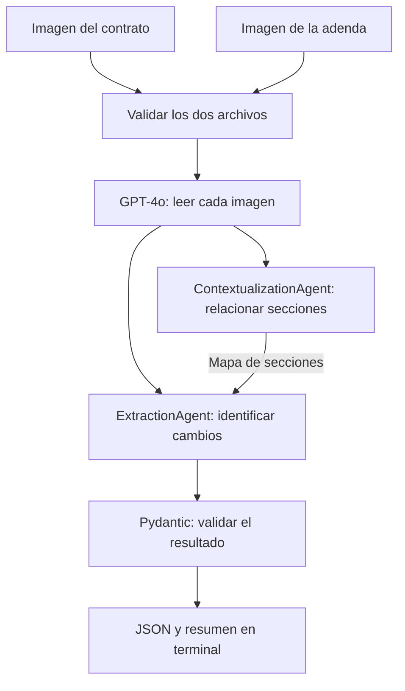

# LegalMove — Comparación de contratos

Este proyecto recibe dos imágenes, una de un contrato y otra de su adenda, y devuelve qué cambió entre los documentos: las cláusulas afectadas, los temas y un resumen con las condiciones anteriores y nuevas.

Parte del caso LegalMove, una empresa de tecnología legal cuyo equipo de Compliance compara contratos manualmente. La idea es ayudar a encontrar los cambios y dejar registrado cómo se obtuvo el resultado para poder revisarlo.

Elegí contratos de producción musical y alquiler de equipos de sonido para los ejemplos. Los cambios incluyen honorarios, plazos, rondas de correcciones, uso de grabaciones y depósitos de garantía. Todos los documentos de prueba son ficticios.

## Cómo funciona



El primer agente arma una ficha con las secciones de los documentos y sus correspondencias. El segundo recibe esa ficha y los dos textos completos para identificar modificaciones, adiciones y eliminaciones. Cada uno tiene su propio system prompt y una responsabilidad distinta.

| Herramienta | Para qué la uso |
| --- | --- |
| Python | Ejecutar el programa y conectar las etapas |
| GPT-4o | Leer las imágenes y analizar los textos |
| LangChain | Armar los mensajes y las llamadas de los dos agentes |
| Pydantic | Validar los campos y tipos del resultado |
| Langfuse | Consultar las entradas, salidas, tiempos y tokens de cada etapa |

## Instalación

Requiere Python 3.12, acceso a internet, una API key de OpenAI con saldo y un proyecto de Langfuse con sus claves.

```bash
git clone https://github.com/GonLucero/henry-ai-engineering.git
cd henry-ai-engineering/M4
python3.12 -m venv .venv
source .venv/bin/activate
python -m pip install -r requirements.txt
cp .env.example .env
```

Completar el archivo `.env` con las claves propias:

```dotenv
OPENAI_API_KEY=tu-clave-de-openai
OPENAI_MODEL=gpt-4o
LANGFUSE_PUBLIC_KEY=tu-clave-publica
LANGFUSE_SECRET_KEY=tu-clave-secreta
LANGFUSE_HOST=https://cloud.langfuse.com
```

La URL de Langfuse debe corresponder a la región del proyecto. También se acepta `LANGFUSE_BASE_URL`, que tiene prioridad cuando están definidas ambas variables. Las variables del entorno tienen prioridad sobre las del archivo `.env`.

`.env.example` es la plantilla para configurar el proyecto. `.env` contiene las claves reales y queda excluido de Git.

Para comprobar la conexión con una llamada breve que consume saldo:

```bash
python scripts/check_connection.py
```

## Probar los ejemplos

Desde `M4`, con el entorno virtual activado:

```bash
# Producción musical: cambio de precio
python src/main.py data/test_contracts/simple/original.png data/test_contracts/simple/adenda.png

# Producción musical: varios cambios, una eliminación y una adición
python src/main.py data/test_contracts/complejo/original.png data/test_contracts/complejo/adenda.png

# Alquiler de sonido: devolución y depósito de garantía
python src/main.py data/test_contracts/alquiler_sonido/original.png data/test_contracts/alquiler_sonido/adenda.png
```

| Caso | Resultado esperado |
| --- | --- |
| Simple | Cláusula 2: honorarios de ARS 300.000 a ARS 360.000 |
| Complejo | Cambian las cláusulas 3, 4 y 5; se elimina la 6 y se agrega la 7 |
| Alquiler de sonido | Cambia la devolución en la cláusula 3 y se agrega el depósito de la 6; se conserva el precio del alquiler |

También probé un control con la misma imagen en ambos argumentos: el resultado esperado son listas vacías, porque las condiciones son iguales.

Los documentos y los cambios esperados están en [data/test_contracts](data/test_contracts/README.md). Los resultados de las ejecuciones verificadas están en [examples](examples/README.md).

Para analizar otros documentos, se pasan sus rutas al mismo comando:

```bash
python src/main.py /ruta/contrato.png /ruta/adenda.jpg
```

## Qué devuelve

El JSON conserva los tres nombres de campo que pide la consigna. Este es un ejemplo de formato:

```json
{
  "sections_changed": ["2"],
  "topics_touched": ["honorarios/precio"],
  "summary_of_the_change": "MODIFICACIÓN. Antes: ARS 300.000. Después: ARS 360.000. Se conserva la forma de pago."
}
```

En la terminal se muestra además un resumen con tokens, duración, costo estimado y enlace a Langfuse. El JSON sale por `stdout`; el resumen y los errores, por `stderr`. Esto permite guardar la respuesta como archivo:

```bash
python src/main.py data/test_contracts/simple/original.png data/test_contracts/simple/adenda.png > resultado.json
```

Cada ejecución exitosa crea una carpeta dentro de `outputs/`:

| Archivo | Contenido |
| --- | --- |
| `original_text.txt` | Transcripción de la imagen original |
| `amendment_text.txt` | Transcripción de la adenda |
| `context_map.txt` | Ficha de secciones del primer agente |
| `report.json` | Resultado final validado |
| `run.json` | Tokens, duración, costo estimado y datos del registro en Langfuse |

`--json-only` omite el resumen de terminal. `--output-dir carpeta` permite elegir dónde guardar las ejecuciones. `outputs/` queda excluida de Git.

## Decisiones que tomé

- **Dos agentes con tareas separadas.** Uno relaciona las secciones y el otro compara las condiciones. Así puedo revisar en qué etapa empezó un error. La comparación de precisión frente a un solo agente queda como evaluación futura.
- **Los textos completos llegan al extractor.** El mapa sirve de orientación; cada cambio se comprueba con los documentos de origen.
- **GPT-4o en todo el flujo.** Es el modelo solicitado para visión y mantuve el mismo en los agentes para simplificar la configuración.
- **Instrucciones afirmativas.** Los prompts describen qué debe producir cada etapa y en qué evidencia apoyarse. El agente de contextualización sigue un formato de ficha para mantener su tarea separada de la extracción.
- **Salida estructurada y Pydantic.** El extractor usa structured outputs y el programa vuelve a validar el resultado. Se comprueban campos, tipos, textos vacíos y duplicados. La exactitud del contenido se revisa contra los documentos.
- **Adendas parciales.** Las cláusulas omitidas conservan su vigencia. Una eliminación requiere evidencia explícita o una sustitución íntegra inequívoca.
- **Validación antes de gastar en la API.** Se revisan ambos archivos: extensión, formato real, integridad y tamaño máximo de 10 MB.

Las llamadas tienen un timeout de 60 segundos y un reintento de transporte. Una respuesta truncada, rechazada o marcada como `[ILEGIBLE]` detiene el análisis con un mensaje de error.

## Revisar una ejecución en Langfuse

Cada ejecución tiene un registro completo, llamado **traza**. El enlace aparece al terminar el comando. Dentro se pueden abrir las etapas y revisar qué recibió y devolvió cada una:

```text
contract-analysis
├── validate_images
├── parse_original_contract
│   └── vision_transcription
├── parse_amendment_contract
│   └── vision_transcription
├── contextualization_agent
│   └── contextualization_llm
├── extraction_agent
│   └── extraction_llm
└── output_validation
```

Las cuatro llamadas al modelo registran modelo, tokens y duración. Las etapas guardan sus entradas y salidas. El programa termina de enviar los registros con `flush()` antes de salir.

También se puede comprobar la recepción de una ejecución desde la terminal:

```bash
python scripts/check_trace.py outputs/NOMBRE_DE_LA_EJECUCION
```

OpenAI recibe las imágenes. Langfuse recibe los textos y los resultados; para las imágenes se registran metadatos, en lugar del contenido base64. Las claves permanecen en la configuración privada.

## Pruebas y resultados

```bash
python -m pytest -q
```

La última verificación completó **22 tests offline**, que se ejecutan sin claves ni consumo de API. Cubren validación de datos e imágenes, respuestas incompletas, el paso de información entre agentes y la salida del programa.

Además se ejecutaron los tres pares y el control con imágenes idénticas usando GPT-4o. Se revisaron los cambios contra los documentos y se verificaron sus registros en Langfuse. Después de reformular los prompts se repitieron los cuatro casos.

El detalle, las métricas y las diferencias observadas están en [verificación](docs/verificacion.md).

## Dónde está cada parte

- `src/main.py`: entrada por terminal, JSON, resumen y archivos de resultados.
- `src/image_parser.py`: validación, base64 y lectura de imágenes.
- `src/agents/`: contextualización y extracción, con sus prompts.
- `src/models.py`: esquema Pydantic de salida.
- `src/pipeline.py`: orden de ejecución y paso de información.
- `src/runtime.py`: clientes, métricas y registros de Langfuse.
- `src/config.py`: carga de variables de entorno.
- `scripts/`: generación de imágenes y comprobación de conexiones y registros.
- `tests/`: pruebas offline.

## Alcance y límites

La entrada es una imagen PNG/JPEG por documento. El alcance actual se concentra en los ejemplos ficticios incluidos; quedan pendientes las pruebas con documentos extensos, varias páginas, manuscritos y fotos degradadas.

Visión puede introducir variaciones de lectura: en los ejemplos musicales apareció “portafolio” donde la imagen decía “portfolio”. Pydantic valida la estructura y la revisión humana confirma el contenido. El reporte sirve como apoyo a la comparación, con la revisión jurídica a cargo de una persona.

El costo mostrado es una estimación local basada en tokens a tarifa de referencia de GPT-4o. La facturación del proveedor es la referencia definitiva, ya que puede aplicar descuentos o incluir llamadas fallidas.

Para recorrer el código y preparar la demostración, dejé una [guía de defensa](docs/defensa.md).
