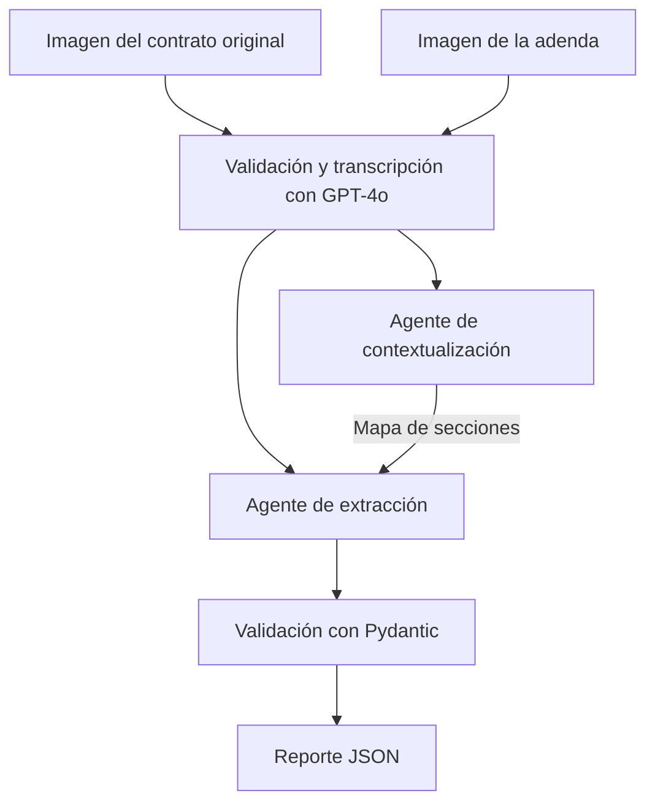

# AI Engineering — Henry

Soy Gonzalo y estoy organizando acá mi trabajo de la carrera de AI Engineering de Henry, cohorte PT06. El repositorio está dividido por módulos para reunir los apuntes, las consignas y las implementaciones a medida que avance.

Mi prioridad actual es el proyecto integrador del M4: comparar un contrato original con su adenda usando visión y dos agentes especializados. Para construirlo voy retomando las bases de los módulos anteriores que necesita cada parte del sistema.

## Organización

| Carpeta | Tema | Proyecto planteado en la consigna |
| --- | --- | --- |
| [m1](m1/) | APIs de modelos, prompting, JSON y métricas | Una utilidad de texto que responde consultas con salida estructurada y registra tokens, latencia y costo |
| [m2](m2/) | Chunking, embeddings, búsqueda vectorial y RAG | Un chatbot de FAQs que recupera información de un documento y muestra los fragmentos usados |
| [m3](m3/) | Agentes, LangChain y observabilidad | Un orquestador que clasifica consultas y las deriva a agentes RAG por departamento |
| [m4](m4/) | Visión, comparación de documentos y validación | LegalMove: un pipeline de análisis de contratos y adendas con trazabilidad en Langfuse |

Por ahora M1, M2 y M3 contienen apuntes, objetivos y listas de pendientes. La implementación de M4 todavía está pendiente. Las carpetas no representan entregas completas.

## Proyecto integrador M4: LegalMove

La consigna plantea el caso de una empresa de tecnología legal cuyo equipo de Compliance compara contratos y adendas manualmente. El objetivo es recibir las imágenes de los dos documentos y devolver un reporte estructurado con las secciones modificadas, los temas afectados y un resumen de los cambios.

El flujo previsto es:



El agente de contextualización organiza las secciones y sus correspondencias. El de extracción recibe ese mapa junto con los dos textos y se ocupa de identificar modificaciones, adiciones y eliminaciones. Langfuse debe registrar las etapas del pipeline y las llamadas al modelo.

La salida requerida tiene tres campos:

```json
{
  "sections_changed": ["Cláusula 3"],
  "topics_touched": ["Honorarios"],
  "summary_of_the_change": "Los honorarios pasan de $100.000 a $150.000."
}
```

Este JSON es solamente un ejemplo de formato, no el resultado de una ejecución.

## Qué quiero comprobar

- Que la transcripción conserve secciones, importes, fechas y negaciones.
- Que los agentes tengan responsabilidades distintas y compartan la información necesaria.
- Que una cláusula no mencionada en una adenda no se interprete automáticamente como eliminada.
- Que el programa valide la estructura de salida y comunique los errores con claridad.
- Que pueda seguir una ejecución completa en Langfuse.

Pydantic puede validar la estructura del reporte, pero eso no garantiza que el contenido sea correcto. Para comprobarlo, la entrega debe incluir al menos dos pares de imágenes: un caso con cambios simples y otro con varios cambios, revisados contra los documentos.

## Relación entre los módulos

De M1 retomo las llamadas a la API, las variables de entorno, el diseño de prompts y las métricas. De M3, la separación de responsabilidades, la orquestación con LangChain y la trazabilidad con Langfuse.

M2 trabaja con RAG y bases vectoriales. Es parte del recorrido del curso, pero la consigna actual de M4 no exige recuperar información de una base externa: la comparación se hace sobre los dos documentos recibidos.

## Configuración

Cada implementación tendrá sus instrucciones de instalación y ejecución dentro de su carpeta. Todavía no hay un comando de ejecución del M4.

Las claves se guardan localmente en archivos `.env`, excluidos por `.gitignore`. Los archivos `.env.example` que se incorporen deben contener únicamente los nombres de las variables y valores de ejemplo.

## Material de referencia

Las consignas son las de Henry provistas en el campus. Estos repositorios se consultan como material docente; no son implementaciones propias:

- [M1: primeros pasos](https://github.com/Ivan-Cepeda/primeros_pasos_ai_engineer)
- [M1: caso OrbitAir](https://github.com/Ivan-Cepeda/IA-Engineer-M1-Orbitair-case)
- [M2: AI Engineer Lab](https://github.com/Ivan-Cepeda/ai-engineer-lab)
- [M3: AI Observability](https://github.com/Ivan-Cepeda/AI-Observability)
- [M4: sistemas multimodales y arquitectura](https://github.com/cTapiaDev/henry-m4-multimodal-architecture)

Los apuntes y pendientes de cada módulo están en su README correspondiente.
