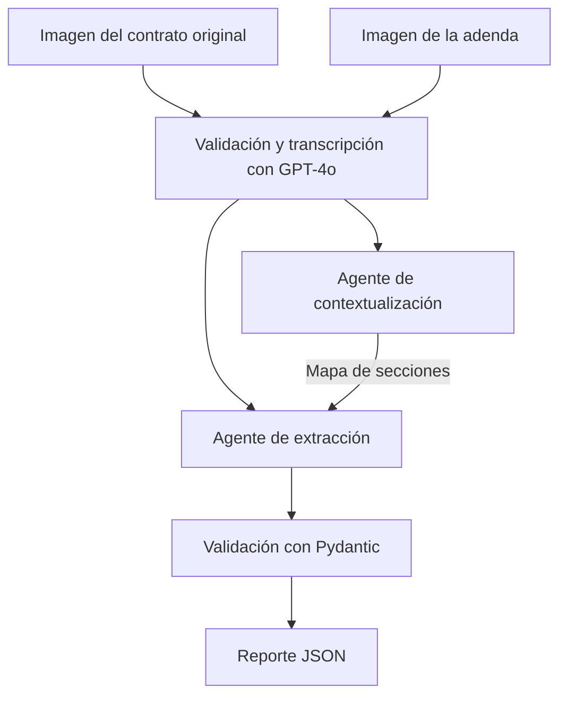

# AI Engineering — Henry

Este repositorio esta dedicado a diferentes modulos de ingeniería de aplicaciones con modelos de lenguaje, desarrollado en el marco de la carrera de AI Engineering de Henry, cohorte PT06.

El recorrido abarca integración con APIs, generación de respuestas estructuradas, recuperación de información y coordinación de agentes. El foco es conectar estas herramientas con problemas concretos y evaluar tanto la calidad de las respuestas como el comportamiento del sistema.

## Organización

| Carpeta | Tema | Aplicación de referencia |
| --- | --- | --- |
| [m1](m1/) | APIs de modelos, prompting, JSON y métricas | Una utilidad de texto que responde consultas con salida estructurada y registra tokens, latencia y costo |
| [m2](m2/) | Chunking, embeddings, búsqueda vectorial y RAG | Un chatbot de FAQs que recupera información de un documento y muestra los fragmentos usados |
| [m3](m3/) | Agentes, LangChain y observabilidad | Un orquestador que clasifica consultas y las deriva a agentes RAG por departamento |
| [m4](m4/) | Visión, comparación de documentos y validación | LegalMove: un pipeline de análisis de contratos y adendas con trazabilidad en Langfuse |

## LegalMove — Comparación de contratos

LegalMove es el proyecto central en desarrollo: una herramienta para asistir en la comparación de contratos y adendas escaneados. Su finalidad es transformar documentos en un reporte procesable por otros sistemas, identificando las secciones modificadas, los temas afectados y las condiciones anteriores y nuevas.

La propuesta combina lectura multimodal, separación de responsabilidades entre agentes y validación de datos. El análisis debe poder inspeccionarse desde la transcripción hasta el reporte final para facilitar la revisión humana.

El flujo previsto es:



El agente de contextualización organiza las secciones y sus correspondencias. El de extracción recibe ese mapa junto con los dos textos y se ocupa de identificar modificaciones, adiciones y eliminaciones. Langfuse debe registrar las etapas del pipeline y las llamadas al modelo.

La salida requerida tiene tres campos:

```json
{
  "sections_changed": ["Cláusula 3"],
  "topics_touched": ["Honorarios"],
  "summary_of_the_change": "Los honorarios pasan de $100.000 a $150.000."
}
```

Este JSON es solamente un ejemplo de formato, no el resultado de una ejecución.

## Criterios técnicos

- Que la transcripción conserve secciones, importes, fechas y negaciones.
- Que los agentes tengan responsabilidades distintas y compartan la información necesaria.
- Que una cláusula no mencionada en una adenda no se interprete automáticamente como eliminada.
- Que el programa valide la estructura de salida y comunique los errores con claridad.
- Que pueda seguir una ejecución completa en Langfuse.

Pydantic puede validar la estructura del reporte, pero eso no garantiza que el contenido sea correcto. Para comprobarlo, la entrega debe incluir al menos dos pares de imágenes: un caso con cambios simples y otro con varios cambios, revisados contra los documentos.

## Relación entre los módulos

De M1 retomo las llamadas a la API, las variables de entorno, el diseño de prompts y las métricas. De M3, la separación de responsabilidades, la orquestación con LangChain y la trazabilidad con Langfuse.

M2 trabaja con RAG y bases vectoriales. Es parte del recorrido del curso, pero la consigna actual de M4 no exige recuperar información de una base externa: la comparación se hace sobre los dos documentos recibidos.

## Configuración

La documentación específica de cada módulo se encuentra en su carpeta. Las instrucciones de instalación y ejecución se incorporan junto con cada implementación.

Las claves se guardan localmente en archivos `.env`, excluidos por `.gitignore`. Los archivos `.env.example` que se incorporen deben contener únicamente los nombres de las variables y valores de ejemplo.

## Material de referencia

Las consignas son las de Henry provistas en el campus. Estos repositorios se consultan como material docente; no son implementaciones propias:

- [M1: primeros pasos](https://github.com/Ivan-Cepeda/primeros_pasos_ai_engineer)
- [M1: caso OrbitAir](https://github.com/Ivan-Cepeda/IA-Engineer-M1-Orbitair-case)
- [M2: AI Engineer Lab](https://github.com/Ivan-Cepeda/ai-engineer-lab)
- [M3: AI Observability](https://github.com/Ivan-Cepeda/AI-Observability)
- [M4: sistemas multimodales y arquitectura](https://github.com/cTapiaDev/henry-m4-multimodal-architecture)

Cada módulo cuenta con un README que desarrolla sus conceptos y alcance.
